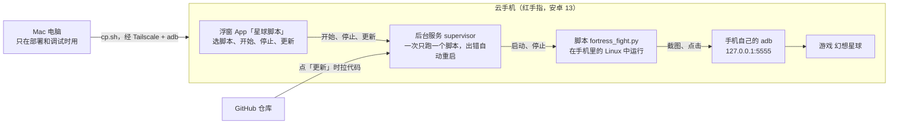

# 星球脚本 云手机使用指南

这套脚本装在红手指云手机里面自己跑，用手机上的浮窗选择、开始和停止；电脑只在第一次部署和调试时用到。技术细节和文件说明见 [README.md](README.md)。

## 这是什么

脚本在手机内部截图（约 0.3 秒一张）和点击，不经过网络。Mac 通过 Tailscale 连到手机，只负责安装环境、放代码和看日志。

## 日常使用

打开浮窗、选一个脚本、点「开始」就行。小圆点默认在右上角，随时可以拖动和点开；脚本运行时它变小、变成半透明的绿色「运行」。

1. 点右上角的紫色小圆点「脚本」，打开面板。小圆点可以拖到别处，但别停在脚本要用的按钮上（比如左上角的基地图标、底部一排按钮）：它会挡住脚本的截图。
2. 面板上方一排是类别（现在只有「星际探险」），点一个类别，下面列出这一类的脚本。选一个脚本，点「开始」。面板会马上收起，免得挡住脚本的视线和点击；结果在屏幕下方短暂提示。
3. 要停止：点小圆点打开面板，点「停止」；也可以下拉通知栏，在「星球脚本」通知里点「停止」。脚本会先做完手上这一步再停：正在换装就换完（换不完就把装备装回原来的船），正在派的那条船派完，后面的船不再派。这可能要一两分钟，最多约 4 分钟，期间面板显示「停止中」。

面板上显示正在跑的脚本、代码版本和最后几行日志，黄色一行是上一个操作的结果。脚本要点的地方正好在小圆点下面时，小圆点会先隐身几秒让开；面板开着挡住它要点的地方时，脚本先等你最多 12 秒，再把面板收起。脚本运行时不要手动操作游戏：你的点击会和脚本的点击互相打乱。

## 可选的脚本

「星际探险」类别里，jx 号的手机有四个脚本：前三个真的出击，最后一个只走一遍流程、不出击。gs 号的手机有自己的两个，见下面「两个号」。其他功能（跑图、战斗、活动等）移植到手机以后，会按类别加进面板。

| 脚本 | 做什么 | 出击 |
| --- | --- | --- |
| 星炽要塞 大中小 41032 | 按船的大小打星炽要塞的守卫，不换装备。大船打 II、I 和无标签守卫，中船打 I 和无标签，小船只打无标签。空闲但能量不满的船先修理。 | 会 |
| 铸械要塞 大中小 41032 | 同上，打铸械要塞。 | 会 |
| 星炽要塞 换装 | 原来的模式：一套最好的装备在船之间换，一次一条船出击。 | 会 |
| 星炽要塞 41032 试跑(不出击) | 走完整流程，到最后的「袭击」确认时取消，用来检查。船的修理是真的。 | 不会 |

41032 是舰队顺序，数字从 0 数（0 = 舰队1）：第一位大船，第二、三位中船，第四、五位小船。所以舰队5是大船，舰队2、1是中船，舰队4、3是小船。大中小模式每次进要塞，把空闲、满能量的船按从大到小一次派完；同一个守卫不会派两条船。

### 两个号：jx 和 gs

两个号各用一台云手机。脚本的逻辑是同一套，每个号只有配置不同，配置就是两样东西：

| | jx（默认） | gs |
| --- | --- | --- |
| 面板里的脚本列表 | `cloudphone/phone/scripts.json` | `cloudphone/phone/scripts.gs.json` |
| 标准装备图 | `pics/mac/zone/loadout_standard.png` | `pics/mac/zone/loadout_standard_gs.png` |

手机上的 `/data/local/tmp/ip/account` 文件里写着这台手机是哪个号（一个词，例如 `gs`）；没有这个文件就是默认的 jx。后台服务按这个名字给面板出脚本列表（没有那个名字的列表就用默认的），脚本按这个名字找自己号的图。写了号名却没有那个号的图，换装模式不会跑，日志里会说缺哪张图：别的号的图认不出这个号的装备。脚本本身不带区分号的参数。

gs 的列表：「铸械要塞 换装」（真的出击）和「铸械要塞 换装 试跑(不出击)」（换装和修理是真的，到最后的「袭击」确认时取消）。

换装模式靠「标准装备图」认出最好的装备在哪条船上，每个号的装备不一样，所以各有一张。号上最好的那套装备换了（换了棋子、神器，或者升了很多级），匹配分数掉到 0.9 以下，脚本就会说找不到带装备的船，这时要在带着整套装备的那条船上重新截这张图。

电脑上，gs 手机的地址写在 `cloudphone/.serial.gs` 里，命令加 `-a gs`，例如 `cloudphone/cp.sh -a gs status`；不加 `-a` 就是 `cloudphone/.serial` 里的 jx 手机。

再加一个号：起个名字（字母和数字），加 `scripts.名字.json` 和 `loadout_standard_名字.png`，把那台手机的地址写进 `cloudphone/.serial.名字`，把这两个新文件提交并推送，再运行 `cloudphone/cp.sh -a 名字 all`，它会在手机上记下号名。`all` 的代码是从 GitHub 拿的，没推送的文件到不了手机；只想先试，可以在 `all` 之后运行 `cloudphone/cp.sh -a 名字 code` 把电脑上的代码放过去。

## 更新代码

代码推到 GitHub 以后，在浮窗点「更新」，手机就用上新代码，不需要电脑。

点「更新」后，手机依次做这几件事：

1. 从 GitHub 拉最新的 main 分支，只拉脚本用到的文件。
2. 更新脚本列表等手机端文件；浮窗 App 有新版本的话也自动装上（小圆点会消失一两秒再出现）。
3. 正在跑的脚本先做完手上这一步（和「停止」一样），再用新代码重启；后台服务自己的代码变了，服务也重启，并接着跑原来的脚本。

GitHub 上没有新东西时，结果是「已是最新」，正在跑的脚本不会被打断。拉代码可能要几分钟，这期间面板的状态里显示「更新中：正在从 GitHub 拉代码」，再点一次「更新」不会重复执行。结果显示在面板的黄色一行，面板收着时在屏幕下方提示，例如「updated to 076f1f3 11-21 20:01」。在 Mac 上也可以用 `cloudphone/cp.sh update`。

有的云手机连 `github.com` 会被限速（能连上，但收不到数据）。网络卡住超过一分钟会放弃并自动再试一次；两次都不行，更新自动改走备用线路 `api.github.com`：只下载和手机上内容不同的文件，面板状态里显示「备用线路」。之后 6 小时内再点「更新」直接走备用线路，不用再等。走备用线路更新后，面板上的代码版本后面带 `+api`。备用线路不登录每小时只能发 60 次请求，一次最多下载 50 个文件，平时的更新只改几个文件，够用；超了会提示，这时等 `github.com` 通了再点，或者用电脑推（`cp.sh code`）。两条线路都不通才显示「更新失败」和原因，旧代码照常运行。

「更新」不会把手机上较新的代码换回旧版本：手机上是电脑刚推来的测试代码（`cp.sh code`），而 GitHub 上的更旧（还没推送）时，会显示「没有更新：GitHub 上的代码比手机上从电脑推来的代码旧」，手机上的代码不变。推送以后再点「更新」。

## 云手机重启以后

点桌面上的「星球脚本」图标，在面板里点「启动服务」，重启前在跑的脚本会自动接着跑。

这一步不需要电脑：浮窗通过手机自己的 adb 启动后台服务，所以开发者选项里的「USB 调试」要一直开着。脚本开始前会自动把游戏切到前台；游戏要求重新登录时，需要你手动登录一次。

## 换新的云手机实例

新实例只要在手机上手动做两件事（打开 USB 调试、登录 Tailscale），其余由 Mac 上的一条命令完成。

1. 打开 USB 调试：设置 → 关于手机 → 连点「版本号」7 次 → 系统 → 开发者选项 → 打开「USB 调试」。红手指会随之在 5555 端口开放 adb。
2. 安装 Tailscale：在手机浏览器里从 `https://pkgs.tailscale.com/stable/` 下载安卓安装包，用和 Mac 同一个账号登录。手机上点登录后，把出现的登录链接拿到已登录的 Mac 上打开确认。
3. 在 Mac 上把手机的 Tailscale 地址写进 `cloudphone/.serial`，例如 `100.104.162.101:5555`；gs 号的手机写进 `cloudphone/.serial.gs`。
4. 在 Mac 上运行 `cloudphone/cp.sh all`（gs 号：`cloudphone/cp.sh -a gs all`）：装好手机里的 Linux 环境、从 GitHub 下载代码、安装浮窗、启动服务，约几分钟。
5. 在新手机上打开游戏并登录。同一个账号只能在一台设备上在线，旧手机或 MuMu 上要先退出游戏。

## 常见问题

遇到问题先看面板上的状态和日志，多数情况按下表处理。

| 情况 | 原因 | 怎么办 |
| --- | --- | --- |
| 面板显示「服务未运行」 | 云手机重启过，或 USB 调试被关掉 | 点「启动服务」；不行就检查开发者选项里的 USB 调试 |
| 游戏提示「账号在其他设备登录」 | 同一个账号在 MuMu 或另一台手机上登录了 | 退出另一台设备的游戏，在云手机上重新登录 |
| 脚本自己停了 | 出错退出：60 秒后自动重启，每小时最多 5 次；正常结束的和试跑的不重启 | 看面板里的日志；超过次数后手动点「开始」 |
| 第一次进要塞要 1～2 分钟 | 新登录后地图停在我们的基地，脚本要从基地拖地图找星炽要塞 | 正常；找到后地图停在要塞附近，之后就快了 |
| 小圆点显示「运行」但游戏没动 | 脚本在等：没有满能量的空闲舰队，或船在修理、航行 | 正常，过一会儿就会动；打开面板看最后几行日志，例如「No idle fleet at 100% hp; waiting」 |
| 点「更新」后好像没反应 | 正在从 GitHub 拉代码，可能要几分钟 | 打开面板，状态里有「更新中」；结果出来后会提示 |
| 代码版本后面有 `+api` | 这台手机连 `github.com` 被限速，上次更新走的是备用线路 | 正常，代码就是那个提交的 |
| 点游戏没反应、画面乱跳 | 脚本也在点，两边互相打乱 | 先停止脚本，再手动玩 |
| 试跑以后船被修理了 | 试跑只在最后的「袭击」前停下，之前的修理是真的 | 正常 |
| 换装模式开头说「No fleet holds the best gear… 一键配队 on fleet N」 | 上次换装被中途打断（强制结束、崩溃），装备散在外面 | 正常：脚本在上次带装备的船上点一键配队把装备收回来，再接着跑 |
| 船的能量偶尔读错（如 39% 读成 33%） | 720p 画面上的文字识别有误差 | 只影响「满不满」的判断，一般不用管 |

## 电脑上的命令

日常使用不需要电脑；Mac 上的 `cloudphone/cp.sh` 用来部署、查看和调试，在仓库根目录下运行。手机地址读 `cloudphone/.serial`，也可以用 `-s 地址:5555` 指定；`-a gs` 选 gs 号的手机（地址在 `cloudphone/.serial.gs`）。

| 命令 | 作用 |
| --- | --- |
| `cp.sh status` | 看正在跑的脚本、代码版本和最后几行日志 |
| `cp.sh log 60` | 看最近 60 行日志 |
| `cp.sh scripts` | 列出脚本和它们的 ID |
| `cp.sh start ID` / `cp.sh stop` | 启动或停止脚本 |
| `cp.sh update` | 从 GitHub 拉最新代码，和浮窗的「更新」一样；加 `--force` 时，即使 GitHub 上的代码更旧也换过去；加 `--api` 时直接走备用线路 `api.github.com` |
| `cp.sh peek` | 把手机屏幕截成小图拉回 Mac，约 1 秒 |
| `cp.sh pull 路径` | 把手机上的调试截图拉回 Mac |
| `cp.sh try 参数…` | 测试：先停掉正在跑的脚本，跑一次指定命令，再恢复原来的脚本 |
| `cp.sh restart` | 重启后台服务，脚本会接着跑 |
| `cp.sh all` | 新实例一键部署（setup + code --github + app + up） |
| `cp.sh setup` / `code` / `app` / `up` | 分步：装环境 / 放代码 / 装浮窗 / 启动服务 |
| `cp.sh sh 命令` | 在手机里的 Linux 中执行命令 |

## 添加脚本和开发新功能

新功能的流程是：在 Mac 上改代码 → 在云手机上测试 → 推到 GitHub → 在浮窗点「更新」。

- 加一个面板里的脚本：在 `cloudphone/phone/scripts.json` 里加一行 `{"group", "id", "name", "args"}`，`group` 是类别名（例如「星际探险」，写一个新名字就多一个类别），`id` 在整个文件里不能重复。服务会自动加上 `--adb 127.0.0.1:5555 --delay 0`，目前只有 `fortress_fight.py` 支持 `--adb`，别的脚本要先移植。
- 测试没推送的改动：`cloudphone/cp.sh code` 把本地代码放到手机上，再用 `cloudphone/cp.sh try fortress_fight.py -oxz 41032 --dry --debug-shots` 跑一次。`try` 会先停掉正在跑的脚本，跑完再恢复。
- 看手机画面用 `cp.sh peek`；看脚本存的调试截图用 `cp.sh pull app/pics/mac/zone/debug/文件名.png`。
- 测完推到 GitHub，再在浮窗点「更新」（或 `cp.sh update`），手机就回到 GitHub 上的代码。没推送就点「更新」，测试代码会保留；确实要回到 GitHub 上的旧代码，用 `cp.sh update --force` 或 `cp.sh code --github`。
- 在 Claude Code 的新会话里提到云手机、换实例、部署或调试，会用上项目里的 `cloudphone` skill（`.claude/skills/cloudphone/SKILL.md`），里面记着完整流程和遇到过的问题。
